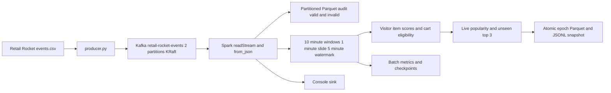

# Real Time E Commerce Session Tracking and Personalization

Technical report: Apache Kafka and PySpark Structured Streaming

## Part A - Theoretical and architectural foundations (30 marks)

### A1 Architecture of Spark Streaming

#### A1.1 DStreams and Structured Streaming

Legacy Spark Streaming represents a DStream as a sequence of RDDs. A batch interval determines when incoming records form a new RDD, and transformations build a graph of recurring RDD computations. Driver scheduling coordinates jobs, while executors perform partition-level operations. Stateful APIs maintain information between intervals, and checkpointing supports recovery of the computation. Receiver-based ingestion and the direct Kafka integration have different recovery characteristics. [2]

Structured Streaming expresses the input as an unbounded table and a declarative query over it. New records incrementally change the result table. The driver coordinates triggers and source offsets, executors parse and aggregate partitions, and a state store retains the required intermediate window state. Spark SQL provides the DataFrame execution engine. This project uses its default micro-batch model, with a five-second trigger. [3]

| Dimension | Legacy DStreams | Structured Streaming |
| --- | --- | --- |
| Main abstraction | Sequence of RDDs | Unbounded input table and result table |
| API style | RDD transformation graph | DataFrame and SQL expressions |
| Time handling | Batch interval and explicit application logic | Event-time columns, windows and watermarks |
| Optimization | User functions often opaque to SQL optimization | Structured expressions expose relational operations |
| State representation | RDD-based state APIs | Managed keyed state store |
| Output semantics | Output operations need application-level care | Output mode plus source and sink recovery contract |
| Fit for this assignment | Possible with more manual time logic | Direct expression of schema and event-time requirements |

Both approaches can process micro-batches. The word Structured does not imply that every record is processed individually. Structured Streaming also has a continuous execution mode with restricted operations and different guarantees; it is unsuitable for this stateful window aggregation and foreachBatch design. The project does not claim sub-second latency simply because the overview mentions that objective. Its measured latency depends on trigger scheduling, backlog, transformation cost and sink work. [2, 3]

The driver is responsible for the streaming query's execution plan and progress. In a micro-batch, it identifies an input offset range, schedules tasks and records whether the batch completed. Executor tasks process data partitions and exchange data during shuffles. A stateful aggregation also reads and updates keyed state. Consequently, streaming performance depends on both source ingestion and the cost of maintaining state and publishing output. Adding topic partitions alone cannot repair an expensive aggregation or sink.

The unbounded-table model explains how a continuous query differs from repeatedly running an ordinary batch program. A static DataFrame has a bounded input. A streaming DataFrame describes input that will continue arriving, and a started streaming query incrementally updates its logical result. The application does not collect the complete historical event log into driver memory. Its aggregation state contains the information needed by the active event-time windows, while Kafka and Parquet retain input and audit history.

#### A1.2 ETL architecture in continuous processing

Extract receives the continuous Kafka log and retains source coordinates. Transform applies the schema, event-time conversion, validity checks, weights and rolling aggregates. Load persists an auditable history and publishes the current recommendation view. These responsibilities matter continuously: one malformed record should remain diagnosable, changing intent must update existing state, and a restart must continue from recorded input progress.

In the project, extraction uses spark.readStream.format("kafka"). The source exposes topic, partition, offset, broker timestamp and message value. Parsing uses from_json with an explicit schema. Core transformations use built-in Spark expressions rather than Python UDFs, allowing the engine to understand types and relational operations. Loading has three independent queries: an append-only Parquet audit, an update-mode intent query with foreachBatch, and a native console sink for classroom observation. Each has its own checkpointLocation. [4]

Stateful transformations differ from stateless ETL. Mapping an event to a weight needs only that row. Computing a visitor-item score needs retained prior events or their aggregate. The 10-minute window and five-minute watermark bound the event-time lifetime of state, while the number of active visitor-item keys still determines its size. Event-time progress can stall while the source is idle, so a watermark is not a wall-clock timer.

Write-ahead logging and checkpointing address related recovery problems. Receiver-based DStreams can write received data to a durable write-ahead log before acknowledging it. Their driver metadata checkpoints and RDD recovery complement this mechanism. Structured Streaming with the direct Kafka source instead relies on Kafka's replayable retained log, checkpointed offset and commit logs, and checkpointed state. Enabling a legacy receiver WAL option is not required by this implementation. [2, 4]

Exactly-once behavior requires more than reading each input once. After a failure, the engine may process the same offset range again. A replayable source, deterministic computation and an idempotent or transactional sink make that replay produce the same logical result. Native Parquet streaming uses its file-sink metadata and query checkpoint. foreachBatch is at least once unless the application supplies retry protection. Part B, section B5 explains the local atomic epoch protocol used here. Console output and diagnostic log messages can repeat, and separate streaming queries do not commit atomically together. [3, 4]

Continuous ETL is necessary because incoming application messages are not already reliable analytical rows. A missing visitor ID would corrupt user grouping; a millisecond timestamp mistakenly interpreted as seconds would corrupt event-time windows; and a string such as "null" used as a transaction ID would change purchase eligibility. Schema enforcement therefore protects business meaning as well as data types. A quarantine or invalid-audit path prevents one bad payload from either silently contaminating results or stopping every valid customer's activity.

An explicit schema also provides an input contract that can be reviewed before execution. The wire contract has five fields, but the curated contract adds event time, validity, weights and source coordinates. Extra input fields can be ignored safely for this version; incompatible changes to required fields must be rejected or introduced through a versioned migration. Changing the state schema or grouping keys of a checkpointed query requires particular care because a running query has persisted more than just files of raw data.

ETL transformations can be classified by their dependencies. Projection, JSON parsing and event weighting are stateless: they depend on one input row. Window aggregation is stateful: the score for a visitor-item key depends on previous rows in the same window. Recommendation ranking is a second dependency: the user's current cart must be considered alongside other items' current popularity. The design makes these dependencies explicit so that late data can update an existing score and a purchase can retract an earlier result.

#### A1.3 Event time, processing time and window state

Event time is the timestamp generated by the shopping activity. Processing time is the time at which Spark handles the message. These differ when clients disconnect, networks delay records, the producer replays historical input or Kafka accumulates a backlog. Using processing time alone would group a delayed click by arrival rather than by the shopping interaction it describes. This assignment therefore converts the original epoch milliseconds into event_time before defining windows.

A 10-minute window with a one-minute slide produces overlapping intervals such as [12:00, 12:10), [12:01, 12:11) and [12:02, 12:12). A click at 12:09 belongs to ten such windows. Overlap smooths the view of recent behavior compared with a single tumbling boundary, but it increases aggregation work and must not be counted repeatedly in a recommendation popularity score. Window duration answers how much activity a score summarizes; slide duration answers how often aligned windows start; watermark delay answers how far event-time progress can lag before old state becomes removable. They are three separate settings.

Suppose the latest observed event time is 12:20 and the conceptual watermark is near 12:15. A record timestamped 12:18 is only two minutes late and can update retained windows. A record timestamped 11:20 has all its 10-minute windows behind that frontier and cannot revise the current state. Spark's actual watermark is updated between triggers, and a record older than the nominal delay is not universally guaranteed to be discarded immediately. The five-minute setting also does not mean Spark waits five wall-clock minutes before every output. Idle input does not continually advance an event-time watermark.

#### A1.4 Output modes, WAL, checkpoints and exactly-once results

Append mode emits rows that will no longer change. For a windowed aggregate with a watermark, this can require waiting until the window is final. Complete mode emits the complete aggregate result and is unsuitable for an indefinitely growing result without careful state bounds. Update mode emits changed aggregate rows and is the appropriate choice when an unpurchased cart should affect recommendations before final window closure. The sink must understand that an update is an absolute aggregate total. If a score changes from 1 to 6, the new value replaces 1; adding 6 to 1 would incorrectly produce 7.

The failure model clarifies why checkpoints matter. Imagine batch 42 reads partition offsets 1000 through 1499. A crash after computation but before the output is committed may cause the same offset range to run again. The input must still exist in Kafka, the query must recover the same state, and the sink must avoid making the logical result twice. A checkpoint records the query identity, source progress and state needed for this recovery. Kafka retention must be long enough to cover the expected outage; a checkpoint cannot reconstruct source data that the broker has already deleted.

A legacy receiver WAL protects records that have arrived at the receiver before their processing finishes. The direct Kafka source instead has a retained, replayable log at the source. Its offset log and batch commit log work with the state checkpoint to recover progress. These mechanisms are related but are not interchangeable configuration switches. It would be misleading to enable a DStream receiver setting and claim that it makes this PySpark foreachBatch callback transactional.

End-to-end exactly-once is a statement about the final effect, not a promise that tasks never execute twice. The required ingredients are replayable input, deterministic transformations, durable progress and a sink with idempotence or transaction boundaries. An external email or payment API would need its own idempotency key or transaction handling. Console text may repeat on recovery. The project's append-only Parquet audit uses Spark's native file-sink commit mechanism; the recommendation callback uses an explicit batch-ID publication protocol. These are separate query contracts, so their commits are not a global distributed transaction.

### A2 Recommender systems with PySpark Structured Streaming

A recommendation engine combines current evidence about a user with a candidate set and ranking rule. Batch systems commonly compute long-term preferences from a historical dataset. Continuous processing can update the current evidence sooner, so a new cart action can change a recommendation before the next batch model refresh. The project separates live features and eligibility from any claim of online model fitting.

Each window stores a score equal to the sum of event weights: 1 for a view, 5 for an add-to-cart and 10 for a transaction. A view followed by a cart scores 6. A transaction raises the same total to 16 but makes that anchor ineligible. Counting transactions independently prevents a larger numerical score from incorrectly triggering an already-completed purchase. Several views alone do not qualify, even if their total exceeds 5.

For each eligible visitor, the strongest qualifying visitor-item pair becomes the anchor. Ties resolve by item ID for deterministic replay. Candidate products come from item popularity measured in the same live serving window. Popularity is the sum of visitor-item intent scores for an item. Products already seen by the visitor in that window are excluded, and the remaining candidates sort by popularity and item ID. The top three are returned with the anchor, score, rank, reason and window boundaries. The candidates and ranks therefore change as the event stream changes.

This baseline is transparent and satisfies real-time recommendation generation using only events.csv. It does not establish category similarity, complementary products or causal sales lift. Popularity may amplify already-popular products, and cold-start traffic can provide too few candidates. Empty output is valid in that case. The product IDs are anonymized, so recommendations remain IDs rather than invented product names.

A production extension could train an implicit-feedback ALS model periodically and serve its candidates using fresh streaming intent. Spark MLlib supports ALS for explicit or implicit feedback, but its model fitting is not automatically an incremental Structured Streaming operation. Evaluation should use a chronological split, recall at K, ranking quality and separate purchase-conversion experiments. This project makes no unmeasured accuracy claim. [10]

There are three useful layers in a recommendation architecture. Candidate generation retrieves a manageable set of possible items. Ranking orders those candidates using user and item features. Eligibility applies business rules, such as excluding already-seen products and suppressing a purchased cart anchor. A real-time stream can update features and eligibility without retraining an entire recommendation model after every click. This distinction is important because the assignment requires immediate personalization from intent signals, but it does not require online ALS training or an accuracy claim.

The continuous advantage can be illustrated with one shopping interaction. At t1 the visitor views an item: the score is 1 and there is no cart intent. At t2 the visitor adds it to the cart: the score becomes 6 and recommendations can be served on the next successful trigger. At t3 the visitor completes a transaction: the score becomes 16 but purchase eligibility becomes false. A nightly batch model might learn this preference later; the streaming feature and rule layer can respond during the interaction. The five-second trigger is a scheduling target, while actual response time includes Kafka delay, batch scheduling, processing and publication.

The historical Retail Rocket replay is a simulation of that behavior. When months of event time are replayed quickly, one micro-batch may contain many original sessions. The current serving snapshot then represents the batch's latest event-time frontier, rather than displaying every intermediate historical recommendation on screen. Every source record still belongs in the audit. The classroom trace separately paces genuine source records to make the cart-to-purchase transition visible. Neither operation invents item identities or presents synthetic product names as source data.

A suitable evaluation separates operational correctness from recommendation usefulness. Correctness checks ask whether the score is right, seen items are excluded, a purchase retracts output and replay preserves the logical effect. Offline ranking evaluation should split chronologically to avoid training on future behavior, then examine recall at K or other ranking measures. Business benefit requires an experiment such as a controlled conversion comparison. The code's deterministic tests establish specific correctness properties; they do not establish a conversion lift or a trained-model accuracy result.

### A3 Real-time distributed ingestion: Kafka versus Flume

#### A3.1 Kafka concepts and distributed operation

Kafka provides an append-only distributed event log. A broker hosts partition replicas. A topic names a logical event stream, and partitions split that stream into ordered logs. A producer chooses the topic and key and publishes records. A consumer reads partition offsets. A consumer group distributes partition ownership among its members so that each assigned partition has one active consumer within that group. Different groups can independently consume the same retained stream. Ordering applies within a partition, not across the whole topic. [5]

The producer keys records by visitorid, keeping one visitor's actions in the same partition under stable partitioning. Two topic partitions allow parallel source reads in Spark local[2]. More consumers than partitions would not create additional partition ownership in one consumer group. After ingestion, Spark separately shuffles visitor-item window keys into aggregation partitions. Kafka source parallelism and Spark shuffle parallelism solve different parts of the workload.

Historically, Kafka used ZooKeeper for coordination and metadata. KRaft instead uses a Kafka controller quorum and Raft-based metadata log. The Compose deployment runs one combined broker-controller process in KRaft mode, so no ZooKeeper service is necessary. Its replication factor is one, which permits a local demonstration but gives no redundant broker copy. A production deployment would separate availability planning from this classroom topology. The pinned Apache Kafka Docker image supports KRaft configuration. [6]

Kafka's strengths include retained replay, partitioned throughput and independent downstream consumers. Its costs include broker operations, partition planning, lag monitoring and retention management. Acknowledgement and replication settings affect durability. This producer uses acks=all, idempotence, bounded retries and up to five in-flight requests with Kafka's idempotent ordering protection. These protect retries within one producer session; they do not identify repeated business events across new CSV replays. A single broker still remains a single failure point. [7, 8]

Flume organizes ingestion as agents containing a source, channel and sink. The source receives events, the channel buffers them and the sink delivers them downstream. Channel choice matters: a memory channel differs from a durable file channel. Transactions between these components support reliable movement, but application and sink behavior still determine end-to-end duplicate handling. Flume suits log collection into Hadoop storage; Kafka better matches this assignment's shared replayable event bus. [9]

| Criterion | Kafka | Flume |
| --- | --- | --- |
| Main abstraction | Partitioned retained event log | Source-channel-sink ingestion agent |
| Replay model | Consumers seek retained offsets | Usually channel delivery until sink acknowledgement |
| Multiple applications | Independent consumer groups | Configure delivery flows and channel fan-out |
| Ordering | Within each topic partition | Depends on the complete agent flow |
| Scaling unit | Broker replicas and topic partitions | Agents, channels and configured flows |
| Storage role | Retained log serves downstream readers | Channel buffers events for delivery |
| Failure handling | Replay, replication and offset tracking | Channel durability and component transactions |
| Typical fit | Event-driven applications and stream processing | Collecting and forwarding logs |
| Operational tradeoff | Cluster and partition management | Agent and flow management |
| Assignment decision | Selected for replay and Spark integration | Compared as an ingestion alternative |

A partition's offset identifies a record's position within that partition. Offset 100 in partition 0 is different from offset 100 in partition 1. The tuple (topic, partition, offset) is therefore retained in the audit and used to check source-coordinate uniqueness. A message key supports partition placement; it does not by itself create a globally unique business event. A consumer position describes reading progress, while an event timestamp describes business time. Confusing these concepts would break either recovery or windowing.

Within a traditional Kafka consumer group, rebalancing moves partition ownership when members join, leave or fail. Parallel consumers are useful only up to the available partition assignments, although each consumer can process many records. Different groups maintain independent progress and can serve separate applications. PySpark's Kafka source integrates this partitioned log with Spark's own task scheduling and checkpoint progress. Its recorded source offsets, rather than an unrelated command-line consumer's committed group position, determine query recovery.

Replication and acknowledgements need to be considered together. A partition leader accepts writes and followers replicate its log. Requiring all in-sync replicas to acknowledge provides a different durability tradeoff from acknowledging only the leader. However, acks=all on a classroom topic with replication factor one still has only one broker copy. It cannot survive loss of that storage. Similarly, idempotent production protects retry duplicates within the producer's broker session; it does not detect a student intentionally rerunning the entire CSV as a fresh ingestion.

KRaft concerns Kafka metadata coordination, not a replacement for topic data partitions or Spark checkpoints. The combined broker-controller process is convenient locally, but a production installation needs an appropriate controller quorum, broker replicas, storage, retention and monitoring. This project's two partitions demonstrate parallel ingestion on one host. That topology satisfies the assignment's local single-node option while making its lack of infrastructure redundancy explicit.

#### A3.2 Integration with PySpark

The application uses org.apache.spark:spark-sql-kafka-0-10_2.12:3.5.7, matching the JVM dependencies bundled with PySpark 3.5.7. The application is written entirely in Python using PySpark. The _2.12 suffix is the required binary compatibility label on the Kafka connector JAR; it does not mean the application is implemented in Scala. The 0-10 name identifies the connector lineage, not a requirement to run a Kafka 0.10 broker. The connector reads binary values plus Kafka coordinates into a streaming DataFrame. startingOffsets=earliest controls a fresh query only. A recovered query resumes checkpointed offsets. Spark manages its source progress rather than using Kafka group commits as the authoritative recovery position. failOnDataLoss=true turns missing retained offsets into an explicit failure. [4]

The producer serializes a visitor key as UTF-8 and the payload as JSON bytes. PySpark reads the Kafka value column, casts it to string and applies from_json with an explicit StructType. The connector handles Kafka transport and offsets; Python DataFrame expressions define business transformations. No .scala source file, Scala application build or Scala streaming program is used. Java is present because Spark's execution engine and Kafka connector run on the JVM under the PySpark API.

#### A3.3 Why Kafka is selected over Flume

The comparison matrix above separates a retained event platform from an ingestion-agent flow. For this assignment, replay is important because students need to stop Spark, recover from offsets and demonstrate independent inspection of the same topic. Kafka also decouples the producer from the Parquet and recommendation consumers. Flume can be a valid log-ingestion choice, especially with a durable channel and appropriate sinks, but it would add a different source-channel-sink configuration without improving the required Kafka-to-PySpark learning objectives.

### A4 Literature review: ETL optimization research

Armbrust et al., Spark SQL: Relational Data Processing in Spark, SIGMOD 2015, DOI 10.1145/2723372.2742797, provides the ETL optimization research basis. The paper explicitly motivates mixed relational and procedural pipelines, including ETL over semi-structured sources. It introduces the DataFrame interface and Catalyst optimizer, which analyzes and transforms query plans and supports code generation and data-source extensions. Its evaluation reports performance benefits over naive procedural Spark implementations for suitable relational workloads. These results belong to the paper's experimental workloads and are not benchmarks for this project. [11]

The practical inference is to expose parsing, projection, filtering, joins and aggregations through built-in DataFrame expressions wherever possible. This implementation follows that approach and persists each foreachBatch result while several sink actions use it. Parquet supplies columnar output and date partitions for inspection. A suitable optimization experiment would compare this baseline with a Python-UDF version on the same input, trigger and machine, recording throughput, batch duration, shuffle and memory. No speedup is assumed in advance. The paper predates Structured Streaming and does not prove this application's watermark correctness or sink atomicity. [11, 13]

Armbrust et al., Structured Streaming: A Declarative API for Real-Time Applications in Apache Spark, SIGMOD 2018, explains how incremental query execution and a declarative API support real-time applications. Its relevance is the separation between a logical query and engine-managed incremental execution. The project applies that model to event-time windows, while implementing the serving snapshot contract explicitly in its sink. Apache documentation supplies version-specific API and recovery details. Together, the papers explain the architecture and optimization rationale, and the implementation tests check concrete behavior. [14]

The research-to-implementation connection is concrete. Explicit fields give the planner usable types; built-in expressions keep parsing and weighting in the relational plan; filtering invalid rows before stateful grouping prevents useless state; and retaining Kafka coordinates makes optimized processing auditable. Persisting a foreachBatch DataFrame is also justified when several output actions need the same changed totals. These choices are testable design decisions rather than evidence of a particular speedup.

An optimization experiment should fix the full source file, hardware, Kafka partitions and trigger settings. One could then compare a built-in-expression baseline with an otherwise equivalent Python-UDF pipeline. Report acknowledged input rate, committed batch duration, state rows, shuffle volume and memory; verify that the outputs remain equivalent. Change one factor at a time and include warm-up and recovery conditions. The present report does not replace that experiment with a quoted paper benchmark.

## Part B - Practical implementation and live demonstration (70 marks)

### B1 Concrete business scenario and design decisions

This project builds a continuous e-commerce pipeline that receives Retail Rocket activity through Kafka, validates each event in PySpark Structured Streaming, tracks weighted visitor intent and publishes product recommendations while a cart remains unpurchased. It also records invalid input, writes partitioned Parquet and retains checkpoints for recovery. The principal design decision is to publish changing window results immediately in update mode and treat the most recent recommendation epoch as a replacement serving snapshot.

The business question is specific: when a visitor shows cart intent for an item, which other currently popular, unseen products could the site suggest before the interaction ends? A nightly batch job would incorporate the cart after the useful intervention period. This implementation updates features and eligibility during successive micro-batches. It demonstrates a deterministic recommendation baseline rather than claiming to train a predictive model online.

The brief leaves the numerical high-intent inequality incomplete and does not specify the sliding interval. This solution uses a threshold of at least 5, a required add-to-cart and zero transactions for the same visitor and item in the serving window. It uses a 10-minute window sliding every minute and the required five-minute event-time watermark. A transaction removes eligibility even though it adds 10 engagement points. Fixed windows are a proxy for recent shopping activity, not a claim to reconstruct exact browser sessions.

All application logic is Python. producer.py uses kafka-python, and streaming_etl.py plus retail/transforms.py and retail/sinks.py use PySpark. The default run reads all 2,756,101 Retail Rocket records from data/events.csv. There is no default sample limit. Full input acknowledgement and full downstream processing are checked separately so that a producer exit alone cannot be mistaken for an end-to-end completion.

### B2 Complete dataset and input contract

The required source is the Retail Rocket e-commerce dataset, specifically events.csv, with exactly 2,756,101 source events in the downloaded archive. The complete file contains 2,664,312 views, 69,332 add-to-cart events and 22,457 transactions. These counts were calculated from the complete CSV. The delivered bundle includes the full original archive and the validated, stably sorted events.csv. The default Docker pipeline and required full replay use that complete CSV without a row limit. A small sample is retained only as an optional development fixture; it is not the classroom dataset. Dataset source and attribution are recorded in data/ATTRIBUTION.md. [1]

| Field | Wire type | Meaning and validation |
| --- | --- | --- |
| timestamp | Integer | UNIX epoch milliseconds, accepted between 2000 and 2100 |
| visitorid | Integer | Nonnegative visitor identifier and Kafka message key |
| event | String | Exactly view, addtocart or transaction |
| itemid | Integer | Nonnegative product identifier |
| transactionid | Integer or null | Required for transactions and null for other events |

An example producer payload is:

```json
{"timestamp":1433221332117,"visitorid":257597,"event":"addtocart","itemid":355908,"transactionid":null}
```

CSV input is read incrementally. The producer converts blank transaction IDs into JSON null and converts identifiers into integers. Spark applies an explicit StructType with LongType identifiers and timestamp input, then uses timestamp_millis to create TimestampType without discarding millisecond precision. The Spark session timezone is UTC. Invalid JSON, missing fields, unsupported actions and inconsistent transaction IDs remain in the audit with is_valid=false and never enter intent aggregation.

The full source file is not globally ordered by event time. scripts/prepare_data.py validates and sorts it using SQLite temporary storage, keeping memory independent of the complete row count. This prevents accidental late-data rejection during historical replay. The producer rejects an unsorted CSV unless the user explicitly enables an out-of-order experiment. A constant replay-clock shift preserves original time differences. Send pacing controls wall-clock load independently of event-time spacing.

The sample and derived dataset outputs retain the dataset's Creative Commons Attribution NonCommercial ShareAlike 4.0 license. Attribution names Retail Rocket and records selection and sorting. The source code uses a separate MIT license. [1, 12]

### B3 Kafka environment and full-data Python producer

docker-compose.yml starts Apache Kafka 3.9.1 with one combined KRaft broker-controller. topic-init creates retail-rocket-events with two partitions and replication factor one after the broker passes its health check. Containers connect to kafka:9092; host clients connect to localhost:29092. A named Kafka volume preserves broker data across container restarts.

data-init uses scripts/ensure_data.py before producer starts. A downloaded submission already has the complete sorted CSV. A Git clone downloads the original archive and runs the disk-backed sorter automatically if that CSV is absent. The preparation guard requires 2,756,101 rows and refuses the 5,000-record fixture as the default source. This makes the single-command route use the full dataset in both distributions.

producer.py reads CSV rows incrementally and validates each event. With interval zero it queues bounded asynchronous sends, uses Kafka batching and waits for every future acknowledgement. At most 2,000 unacknowledged futures are held by the replay loop. A positive --interval enables a slower paced replay. The producer uses acks=all, idempotence, bounded retries and up to five in-flight requests. It fails if the expected full row count is not acknowledged or if any invalid source row was skipped.

After success, runtime/producer_complete.json records the acknowledged count, event-category counts, timestamp shift and first/last offsets for each partition. It is an input-completion receipt, not a downstream-success claim. --replay-clock applies one constant timestamp shift to the entire file; it preserves original event-time gaps and does not claim that months of activity occurred in a few wall-clock minutes. Replaying that CSV again creates fresh Kafka offsets and must be treated as a deliberate second ingestion.

### B4 PySpark extraction, windows and recommendation logic

The architecture has a Kafka ingestion boundary, a Spark transformation boundary and persistent output boundaries. The diagram below maps the actual modules and storage paths.



The aggregation key is window, visitorid and itemid. For every key, Spark maintains intent_score, event_count, cart_count, transaction_count and last_event_time. Each event belongs to ten overlapping 10-minute windows when the slide is one minute. A window is half open: its start is included and its end is excluded.

The watermark expression appears before aggregation: withWatermark("event_time", "5 minutes"). Conceptually, the event-time frontier advances behind the greatest observed valid event time. Spark can retain and update state for late data within its guarantee and remove sufficiently old windows. Data beyond the threshold is not guaranteed to be processed. It is incorrect to promise that every older row is always dropped immediately. The acceptance test places its rejected event far enough behind that every affected window has expired. Idle input does not advance the frontier. [3]

Recommendation ranking must avoid summing ten overlapping representations of the same activity. The application selects one aligned current serving window. With M as the latest observed event time in milliseconds, its start is floor(M / 60000) multiplied by 60000, minus 540000. Its end is ten minutes later. This is the earliest still-active sliding window. It spans approximately the previous nine to ten minutes at the current event-time frontier. It is a precise aligned window, rather than an exact continuous interval from M minus ten minutes to M.

The foreachBatch callback receives only changed aggregate totals in update mode. It merges them with the previous committed snapshot using window boundaries, visitorid and itemid as the key. A new total replaces the old total; it is never added to it. The sink removes windows whose end is at or before its event-time cutoff, computes live recommendations from the selected aligned window, writes all files in a staging epoch and publishes that epoch using a same-filesystem rename.

Recommendations require three conditions: intent_score at least 5, cart_count greater than zero and transaction_count equal to zero. Suppression is scoped to the same visitor-item pair in the serving window. A visitor who purchased one item can still qualify through a different unpurchased cart item. The snapshot is recomputed from retained aggregate state, so unchanged popular candidates remain available across batches. A new transaction or a window change can remove a previously visible recommendation. Serving clients always read the greatest completed batch directory, including an empty recommendation snapshot.

The critical parsing and event-time operations use the Python DataFrame API:

```python
raw = spark.readStream.format("kafka").option(
    "kafka.bootstrap.servers", "kafka:9092"
).option("subscribe", "retail-rocket-events").load()
payload = F.from_json(F.col("value").cast("string"), EVENT_SCHEMA)
event_time = F.timestamp_millis(F.col("timestamp"))
# The delivered aggregate_intent function applies these window settings:
events.withWatermark("event_time", "5 minutes").groupBy(
    F.window("event_time", "10 minutes", "1 minute"), "visitorid", "itemid"
)
```

The deployed query uses a five-second trigger, two shuffle partitions and maxOffsetsPerTrigger=25000. These are workload settings, not measured throughput promises. Each input can expand into ten window keys, so the maximum input batch size must be selected with state and driver memory in mind. The Docker driver is allocated 4 GB. The full historical replay is completed before the timed classroom presentation; its duration depends on the actual laptop.

### B5 Logging, partitioned output and recovery

The curated audit is partitioned by is_valid and ingest_date. It retains raw_json, typed fields, event time, Kafka timestamp, ingestion timestamp, topic, partition and offset. Invalid records remain recoverable for diagnosis. Intent state and nonempty recommendation Parquet are partitioned by event_date inside each epoch. Empty recommendations have a schema-bearing empty Parquet output and an empty JSONL serving view.

The ProgressLogger writes structured JSON per query with batch_id, raw record_count, trigger execution_ms, input and processing rates, event-time statistics, source offsets and state-operator metrics. It also records query_id and run_id to verify recovery. Epoch manifests separately record changed aggregate rows, retained state rows, recommendation rows, event maximum and callback execution time. A raw record count differs from aggregate rows because one event can update ten windows. Monitoring these separate quantities prevents misleading throughput claims. Spark's UI and instrumentation support examining the associated jobs and stages. [15]

The local epoch protocol handles process failures as follows:

1. If a failure occurs before publication, readers continue to see the previous committed epoch. A retry recomputes the uncommitted epoch. Abandoned dot-prefixed staging directories are ignored.
2. If publication succeeds but Spark has not committed the batch, the same batch ID may replay. The callback completely consumes that stateful batch, sees the completed epoch and skips republishing it.
3. After the Spark checkpoint commits the batch, recovery continues with the next offset range and saved window state.

The completed epoch directory contains both state and recommendation files, plus a manifest. The rename publishes them together on the supported local filesystem. This contract assumes one writer and intact persistent directories. It is not an object-storage transaction protocol, does not protect arbitrary disk corruption or power-loss ordering, and cannot make unrelated external APIs exactly once. A production implementation should use a transactional table or an idempotent service with a stable business key where those guarantees are required.

The Parquet audit and intent query progress independently, so their most recent batch can temporarily differ. Recovery preserves Kafka volumes, each checkpoint and the sink epoch directory together. Deleting only checkpoints while retaining old epoch IDs violates the protocol. Replaying the CSV creates fresh Kafka offsets, so source-coordinate uniqueness cannot deduplicate that separate ingestion run. The original schema has no globally unique event ID, and identical clicks must not be discarded merely because their five fields match.

### B6 Setup and full-dataset completion procedure

Use Docker Engine or Docker Desktop with Linux containers and Compose v2.20 or newer. Allow approximately 12 GB available memory and 15 GB free disk for the full local exercise; 16 GB host RAM is preferable. The image contains Python 3.11, Java 17, PySpark 3.5.7, kafka-python 2.2.15 and PyArrow 19.0.1. Host Python and Java are not required for the supported Docker route.

From the repository root, start the complete pipeline:

```powershell
docker compose up --build -d
docker compose ps -a
docker compose logs -f data-init producer spark
```

The full producer has no row limit and exits after all acknowledgements. Kafka and PySpark remain active. Build and complete the initial replay before class; the 10-15-minute presentation duration is not a promise that the complete dataset will process within that time on every machine. Verify full downstream completion with:

```powershell
docker compose --profile tools run --rm verify-full
```

scripts/verify_full_replay.py waits for the full producer receipt, filters Parquet by its exact Kafka partition-offset ranges, and waits for the intent query's committed source progress to catch up. It then checks exactly 2,756,101 rows, matching event counts, valid records, both partitions and unique source coordinates using a disk-backed SQLite key. The verifier reads the committed file list in _spark_metadata, including its latest compaction, rather than blindly scanning every physical Parquet file. This excludes abandoned, uncommitted files after a failed write. [16] Only a successful check writes runtime/full_replay_verified.json. This is the evidence to show when stating that the full dataset completed end to end.

Inspect the topic, messages and physical Parquet output:

```powershell
docker compose exec kafka /opt/kafka/bin/kafka-topics.sh `
  --bootstrap-server kafka:9092 --describe --topic retail-rocket-events
docker compose exec kafka /opt/kafka/bin/kafka-console-consumer.sh `
  --bootstrap-server kafka:9092 --topic retail-rocket-events `
  --from-beginning --max-messages 5
docker compose run --rm --no-deps spark python scripts/inspect_output.py --parquet
```

Open the Spark UI at localhost:4040. Inspect progress.jsonl for batch ID, raw record count and execution time; inspect the latest completed epoch for current recommendations. Do not sum every historical epoch. README.md supplies recovery, reset and troubleshooting commands. Keep Kafka data, checkpoints and epoch outputs together when restarting.

### B7 Classroom live demonstration: 13 minutes using the full dataset

The classroom demonstration has two stages. Before class, run the complete 2,756,101-event replay and retain its verified full-source receipt. During the 13-minute presentation, show that evidence and replay an actual short shopping trace selected directly from the complete events.csv. This second stage makes the real-time transition visible without replacing the full-source ingestion with a sample or invented IDs. It deliberately creates fresh Kafka offsets for the selected real records and is labeled as a controlled second replay.

The delivered selector found genuine records for visitor 732139 and item 61273: a view at 1430632474376, add-to-cart at 1430632475470 and transaction 3099 at 1430632522402. Nearby genuine views supply candidate items. scripts/live_demo.py reads these records from the CSV at runtime rather than hardcoding the visitor or item. It shifts all selected timestamps by the same constant and starts beyond prior active state, preserving original relative event times while isolating the visible cart transition.

```powershell
docker compose --profile tools run --rm demo
```

The demo refuses to start unless full_replay_verified.json confirms the complete source. It prints original timestamps and Kafka coordinates, sends genuine candidate views and the selected view/cart, waits for recommendations, then sends the actual transaction and verifies retraction. Controlled synthetic late or malformed events belong to the separate acceptance test, not to the full-data classroom replay.

| Time | Demonstration and evidence |
| --- | --- |
| 0-2 minutes | Explain the business question, full dataset counts and 1/5/10 weights |
| 2-4 minutes | Show Kafka topic with two partitions and full producer completion receipt |
| 4-6 minutes | Show full_replay_verified.json, Parquet row verification and PySpark batch logs |
| 6-9 minutes | Execute genuine CSV cart/purchase trace and display recommendation retraction |
| 9-11 minutes | Show partitioned output, watermark/state metrics and checkpoint commits |
| 11-13 minutes | Restart PySpark, replay a genuine trace and verify preserved query identity |

DEMO.md contains the exact command sequence, pre-class checks and answers to likely oral questions. If a restart or processing step takes longer than the allotted segment, label saved evidence as a previous executed run. Never describe an unexecuted acceptance script as a successful demonstration.

### B8 Validation evidence and assignment coverage

The local verification uses real PySpark DataFrames and the delivered transformations. Twenty-one tests cover source validation, nulls, transaction consistency, window boundaries, CSV pacing, asynchronous acknowledgement, acknowledgement failure, refusal of incomplete full input, genuine trace selection, schema parsing, weights, purchase suppression, unseen candidates, replacement merges, state expiry, duplicate-coordinate rejection, invalid audit rejection, committed-file metadata and intent progress checks.

| Check group | Scope | Evidence status |
| --- | --- | --- |
| Python producer and preparation | Eleven unit tests including full-input and asynchronous-send guards | Executed locally; final result recorded in VALIDATION.md |
| PySpark transformations | Five Java 17 and PySpark 3.5.7 tests | Executed locally; final result recorded in VALIDATION.md |
| Completion verifier | Five tests for counts, duplicates, invalid input, progress and orphan exclusion | Executed locally and passed |
| Full source preparation | Validate and stably sort all 2,756,101 events; check category counts and order | Executed successfully |
| Genuine demo source | Select actual view/cart/purchase and candidate records from complete CSV | Executed successfully |
| Full Docker replay | All source rows acknowledged, persisted once and consumed by intent query | Verifier and CI workflow provided; requires Linux Docker execution |
| Watermark and invalid-input acceptance | Both partitions, late input, score changes, audit and checkpoints | Separate controlled test provided |
| Sink failure and driver recovery | Retry after publication, retained query ID and unique coordinates | Fault test and restart checks provided |

Docker and WSL were absent on the preparation machine. Portable Java and PySpark enable meaningful local transformation checks, but they do not prove that the Docker deployment ran. The report therefore separates executed source/tests from pending container acceptance. The GitHub Actions workflow builds the image, runs the unit and sink tests, replays the full dataset, verifies it, runs controlled acceptance, restarts Spark and saves logs and receipts. The selected submission repository is https://github.com/hoducmanh222/Kafka-Spark.

REQUIREMENTS.md maps every Part A question, Part B task and required deliverable to report sections and code. The source brief omits the numeric intent inequality and the slide interval. This implementation explicitly documents score >=5 with cart_count>0 and transaction_count=0, plus a one-minute slide. These choices are consistent across PySpark, tests, report and slides.

### B9 Limitations and improvements

The implementation meets the assignment's required components with explicit time and output semantics. Its five-second trigger gives an observable classroom pipeline, but batch work can exceed that interval. Watermarks bound state lifetime in event time, not active key cardinality. Highly popular items or unusually active visitors can produce skew, and unrealistic future timestamps can advance the stream frontier prematurely. Type and date-range validation alone do not solve all clock-quality problems.

The sink rewrites retained aggregate snapshots and computes eligible-user candidate combinations in batch DataFrames. This favors clarity and restart inspection for a local assignment. It should be benchmarked before scaling to large concurrent traffic. Historical epochs accumulate on disk and need an explicit retention policy that preserves the latest committed state and any required audit evidence. The single broker and local Spark driver provide no infrastructure redundancy.

Useful extensions include a transactional serving table, scheduled Parquet compaction, more Kafka replicas, candidate retrieval before ranking, item metadata for related-product recommendations and an offline trained candidate model refreshed alongside streaming features. These changes should preserve purchase suppression and measured replay behavior. The current result is a Python and PySpark implementation with complete Retail Rocket input, source attribution, automated checks, a 13-minute demonstration guide and presentation materials. The supplied repository must be pushed to the team's remote and the full-stack checks executed before final classroom submission.

## References

[1] Retail Rocket. Retailrocket recommender system dataset. Kaggle. Dataset and metadata accessed 10 October 2026. https://www.kaggle.com/datasets/retailrocket/ecommerce-dataset

[2] Apache Spark. Spark Streaming programming guide, version 3.5.7. https://spark.apache.org/docs/3.5.7/streaming-programming-guide.html

[3] Apache Spark. Structured Streaming programming guide, version 3.5.7. https://spark.apache.org/docs/3.5.7/structured-streaming-programming-guide.html

[4] Apache Spark. Structured Streaming and Kafka integration guide, version 3.5.7. https://spark.apache.org/docs/3.5.7/structured-streaming-kafka-integration.html

[5] Apache Kafka. Introduction, version 3.9. https://kafka.apache.org/39/getting-started/introduction/

[6] Apache Kafka. Docker, version 3.9. https://kafka.apache.org/39/getting-started/docker/

[7] Apache Kafka. Design, version 3.9. https://kafka.apache.org/39/design/design/

[8] Apache Kafka. Producer configurations, version 3.9. https://kafka.apache.org/39/configuration/producer-configs/

[9] Apache Flume. User guide, version 1.11.0. https://flume.apache.org/FlumeUserGuide.html

[10] Apache Spark. Collaborative filtering, version 3.5.7. https://spark.apache.org/docs/3.5.7/ml-collaborative-filtering.html

[11] Armbrust, M. et al. Spark SQL: Relational Data Processing in Spark. Proceedings of ACM SIGMOD, 2015, pp. 1383-1394. DOI 10.1145/2723372.2742797. Author-hosted paper: https://jkbradley.github.io/assets/papers/2015_sigmod_spark_sql.pdf

[12] Creative Commons. Attribution NonCommercial ShareAlike 4.0 International. https://creativecommons.org/licenses/by-nc-sa/4.0/

[13] Apache Spark. SQL performance tuning, version 3.5.7. https://spark.apache.org/docs/3.5.7/sql-performance-tuning.html

[14] Armbrust, M. et al. Structured Streaming: A Declarative API for Real-Time Applications in Apache Spark. Proceedings of ACM SIGMOD, 2018, pp. 601-613. Author-hosted paper: https://people.eecs.berkeley.edu/~matei/papers/2018/sigmod_structured_streaming.pdf

[15] Apache Spark. Monitoring and instrumentation, version 3.5.7. https://spark.apache.org/docs/3.5.7/monitoring.html

[16] Apache Spark. FileStreamSinkLog and SinkFileStatus implementation, version 3.5.7. Committed file visibility and metadata format. https://github.com/apache/spark/blob/v3.5.7/sql/core/src/main/scala/org/apache/spark/sql/execution/streaming/FileStreamSinkLog.scala
