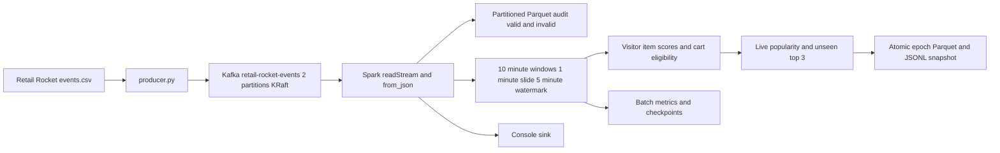

# Real Time E Commerce Session Tracking and Personalization

Technical report for the Retail Rocket Kafka and Spark Streaming assignment

## 1 Purpose and business scenario

This project builds a continuous e-commerce pipeline that receives Retail Rocket activity through Kafka, validates each event in PySpark Structured Streaming, tracks weighted visitor intent and publishes product recommendations while a cart remains unpurchased. It also records invalid input, writes partitioned Parquet and retains checkpoints for recovery. The principal design decision is to publish changing window results immediately in update mode and treat the most recent recommendation epoch as a replacement serving snapshot.

The business question is specific: when a visitor shows cart intent for an item, which other currently popular, unseen products could the site suggest before the interaction ends? A nightly batch job would incorporate the cart after the useful intervention period. This implementation updates features and eligibility during successive micro-batches. It demonstrates a deterministic recommendation baseline rather than claiming to train a predictive model online.

The brief leaves the numerical high-intent inequality incomplete and does not specify the sliding interval. This solution uses a threshold of at least 5, a required add-to-cart and zero transactions for the same visitor and item in the serving window. It uses a 10-minute window sliding every minute and the required five-minute event-time watermark. A transaction removes eligibility even though it adds 10 engagement points. Fixed windows are a proxy for recent shopping activity, not a claim to reconstruct exact browser sessions.

## 2 Dataset and input contract

The required source is the Retail Rocket e-commerce dataset, specifically events.csv, with approximately 2.75 million events. The project includes the earliest 5,000 genuine records, sorted by timestamp, and a downloader plus disk-backed sorter for the complete file. The sample contains 4,879 views, 98 add-to-cart events and 23 transactions. These sample counts were calculated from the downloaded CSV. Dataset source and attribution are recorded in data/ATTRIBUTION.md. [1]

| Field | Wire type | Meaning and validation |
| --- | --- | --- |
| timestamp | Integer | UNIX epoch milliseconds, accepted between 2000 and 2100 |
| visitorid | Integer | Nonnegative visitor identifier and Kafka message key |
| event | String | Exactly view, addtocart or transaction |
| itemid | Integer | Nonnegative product identifier |
| transactionid | Integer or null | Required for transactions and null for other events |

An example producer payload is:

```json
{"timestamp":1433221332117,"visitorid":257597,"event":"addtocart","itemid":355908,"transactionid":null}
```

CSV input is read incrementally. The producer converts blank transaction IDs into JSON null and converts identifiers into integers. Spark applies an explicit StructType with LongType identifiers and timestamp input, then uses timestamp_millis to create TimestampType without discarding millisecond precision. The Spark session timezone is UTC. Invalid JSON, missing fields, unsupported actions and inconsistent transaction IDs remain in the audit with is_valid=false and never enter intent aggregation.

The full source file is not globally ordered by event time. scripts/prepare_data.py validates and sorts it using SQLite temporary storage, keeping memory independent of the complete row count. This prevents accidental late-data rejection during historical replay. The producer rejects an unsorted CSV unless the user explicitly enables an out-of-order experiment. A constant replay-clock shift preserves original time differences. Send pacing controls wall-clock load independently of event-time spacing.

The sample and derived dataset outputs retain the dataset's Creative Commons Attribution NonCommercial ShareAlike 4.0 license. Attribution names Retail Rocket and records selection and sorting. The source code uses a separate MIT license. [1, 12]

## 3 Architecture of Spark Streaming

Legacy Spark Streaming represents a DStream as a sequence of RDDs. A batch interval determines when incoming records form a new RDD, and transformations build a graph of recurring RDD computations. Driver scheduling coordinates jobs, while executors perform partition-level operations. Stateful APIs maintain information between intervals, and checkpointing supports recovery of the computation. Receiver-based ingestion and the direct Kafka integration have different recovery characteristics. [2]

Structured Streaming expresses the input as an unbounded table and a declarative query over it. New records incrementally change the result table. The driver coordinates triggers and source offsets, executors parse and aggregate partitions, and a state store retains the required intermediate window state. Spark SQL provides the DataFrame execution engine. This project uses its default micro-batch model, with a five-second trigger. [3]

| Dimension | Legacy DStreams | Structured Streaming |
| --- | --- | --- |
| Main abstraction | Sequence of RDDs | Unbounded input table and result table |
| API style | RDD transformation graph | DataFrame and SQL expressions |
| Time handling | Batch interval and explicit application logic | Event-time columns, windows and watermarks |
| Optimization | User functions often opaque to SQL optimization | Structured expressions expose relational operations |
| State representation | RDD-based state APIs | Managed keyed state store |
| Output semantics | Output operations need application-level care | Output mode plus source and sink recovery contract |
| Fit for this assignment | Possible with more manual time logic | Direct expression of schema and event-time requirements |

Both approaches can process micro-batches. The word Structured does not imply that every record is processed individually. Structured Streaming also has a continuous execution mode with restricted operations and different guarantees; it is unsuitable for this stateful window aggregation and foreachBatch design. The project does not claim sub-second latency simply because the overview mentions that objective. Its measured latency depends on trigger scheduling, backlog, transformation cost and sink work. [2, 3]

## 4 Continuous ETL and fault tolerance

Extract receives the continuous Kafka log and retains source coordinates. Transform applies the schema, event-time conversion, validity checks, weights and rolling aggregates. Load persists an auditable history and publishes the current recommendation view. These responsibilities matter continuously: one malformed record should remain diagnosable, changing intent must update existing state, and a restart must continue from recorded input progress.

In the project, extraction uses spark.readStream.format("kafka"). The source exposes topic, partition, offset, broker timestamp and message value. Parsing uses from_json with an explicit schema. Core transformations use built-in Spark expressions rather than Python UDFs, allowing the engine to understand types and relational operations. Loading has three independent queries: an append-only Parquet audit, an update-mode intent query with foreachBatch, and a native console sink for classroom observation. Each has its own checkpointLocation. [4]

Stateful transformations differ from stateless ETL. Mapping an event to a weight needs only that row. Computing a visitor-item score needs retained prior events or their aggregate. The 10-minute window and five-minute watermark bound the event-time lifetime of state, while the number of active visitor-item keys still determines its size. Event-time progress can stall while the source is idle, so a watermark is not a wall-clock timer.

Write-ahead logging and checkpointing address related recovery problems. Receiver-based DStreams can write received data to a durable write-ahead log before acknowledging it. Their driver metadata checkpoints and RDD recovery complement this mechanism. Structured Streaming with the direct Kafka source instead relies on Kafka's replayable retained log, checkpointed offset and commit logs, and checkpointed state. Enabling a legacy receiver WAL option is not required by this implementation. [2, 4]

Exactly-once behavior requires more than reading each input once. After a failure, the engine may process the same offset range again. A replayable source, deterministic computation and an idempotent or transactional sink make that replay produce the same logical result. Native Parquet streaming uses its file-sink metadata and query checkpoint. foreachBatch is at least once unless the application supplies retry protection. Section 9 explains the local atomic epoch protocol used here. Console output and diagnostic log messages can repeat, and separate streaming queries do not commit atomically together. [3, 4]

## 5 Real time recommendation systems

A recommendation engine combines current evidence about a user with a candidate set and ranking rule. Batch systems commonly compute long-term preferences from a historical dataset. Continuous processing can update the current evidence sooner, so a new cart action can change a recommendation before the next batch model refresh. The project separates live features and eligibility from any claim of online model fitting.

Each window stores a score equal to the sum of event weights: 1 for a view, 5 for an add-to-cart and 10 for a transaction. A view followed by a cart scores 6. A transaction raises the same total to 16 but makes that anchor ineligible. Counting transactions independently prevents a larger numerical score from incorrectly triggering an already-completed purchase. Several views alone do not qualify, even if their total exceeds 5.

For each eligible visitor, the strongest qualifying visitor-item pair becomes the anchor. Ties resolve by item ID for deterministic replay. Candidate products come from item popularity measured in the same live serving window. Popularity is the sum of visitor-item intent scores for an item. Products already seen by the visitor in that window are excluded, and the remaining candidates sort by popularity and item ID. The top three are returned with the anchor, score, rank, reason and window boundaries. The candidates and ranks therefore change as the event stream changes.

This baseline is transparent and satisfies real-time recommendation generation using only events.csv. It does not establish category similarity, complementary products or causal sales lift. Popularity may amplify already-popular products, and cold-start traffic can provide too few candidates. Empty output is valid in that case. The product IDs are anonymized, so recommendations remain IDs rather than invented product names.

A production extension could train an implicit-feedback ALS model periodically and serve its candidates using fresh streaming intent. Spark MLlib supports ALS for explicit or implicit feedback, but its model fitting is not automatically an incremental Structured Streaming operation. Evaluation should use a chronological split, recall at K, ranking quality and separate purchase-conversion experiments. This project makes no unmeasured accuracy claim. [10]

## 6 Distributed ingestion with Kafka and Flume

Kafka provides an append-only distributed event log. A broker hosts partition replicas. A topic names a logical event stream, and partitions split that stream into ordered logs. A producer chooses the topic and key and publishes records. A consumer reads partition offsets. A consumer group distributes partition ownership among its members so that each assigned partition has one active consumer within that group. Different groups can independently consume the same retained stream. Ordering applies within a partition, not across the whole topic. [5]

The producer keys records by visitorid, keeping one visitor's actions in the same partition under stable partitioning. Two topic partitions allow parallel source reads in Spark local[2]. More consumers than partitions would not create additional partition ownership in one consumer group. After ingestion, Spark separately shuffles visitor-item window keys into aggregation partitions. Kafka source parallelism and Spark shuffle parallelism solve different parts of the workload.

Historically, Kafka used ZooKeeper for coordination and metadata. KRaft instead uses a Kafka controller quorum and Raft-based metadata log. The Compose deployment runs one combined broker-controller process in KRaft mode, so no ZooKeeper service is necessary. Its replication factor is one, which permits a local demonstration but gives no redundant broker copy. A production deployment would separate availability planning from this classroom topology. The pinned Apache Kafka Docker image supports KRaft configuration. [6]

Kafka's strengths include retained replay, partitioned throughput and independent downstream consumers. Its costs include broker operations, partition planning, lag monitoring and retention management. Acknowledgement and replication settings affect durability. This producer uses acks=all, idempotence, bounded retries and one in-flight request to preserve retry ordering. These protect retries within one producer session; they do not identify repeated business events across new CSV replays. A single broker still remains a single failure point. [7, 8]

Flume organizes ingestion as agents containing a source, channel and sink. The source receives events, the channel buffers them and the sink delivers them downstream. Channel choice matters: a memory channel differs from a durable file channel. Transactions between these components support reliable movement, but application and sink behavior still determine end-to-end duplicate handling. Flume suits log collection into Hadoop storage; Kafka better matches this assignment's shared replayable event bus. [9]

| Criterion | Kafka | Flume |
| --- | --- | --- |
| Main abstraction | Partitioned retained event log | Source-channel-sink ingestion agent |
| Replay model | Consumers seek retained offsets | Usually channel delivery until sink acknowledgement |
| Multiple applications | Independent consumer groups | Configure delivery flows and channel fan-out |
| Ordering | Within each topic partition | Depends on the complete agent flow |
| Scaling unit | Broker replicas and topic partitions | Agents, channels and configured flows |
| Storage role | Retained log serves downstream readers | Channel buffers events for delivery |
| Failure handling | Replay, replication and offset tracking | Channel durability and component transactions |
| Typical fit | Event-driven applications and stream processing | Collecting and forwarding logs |
| Operational tradeoff | Cluster and partition management | Agent and flow management |
| Assignment decision | Selected for replay and Spark integration | Compared as an ingestion alternative |

## 7 Connector integration and research literature

The application uses org.apache.spark:spark-sql-kafka-0-10_2.12:3.5.7, matching Spark 3.5.7 and Scala 2.12. The 0-10 name identifies the connector lineage, not a requirement to run a Kafka 0.10 broker. The connector reads binary values plus Kafka coordinates into a streaming DataFrame. startingOffsets=earliest controls a fresh query only. A recovered query resumes checkpointed offsets. Spark manages its source progress rather than using Kafka group commits as the authoritative recovery position. failOnDataLoss=true turns missing retained offsets into an explicit failure. [4]

Armbrust et al., Spark SQL: Relational Data Processing in Spark, SIGMOD 2015, DOI 10.1145/2723372.2742797, provides the ETL optimization research basis. The paper explicitly motivates mixed relational and procedural pipelines, including ETL over semi-structured sources. It introduces the DataFrame interface and Catalyst optimizer, which analyzes and transforms query plans and supports code generation and data-source extensions. Its evaluation reports performance benefits over naive procedural Spark implementations for suitable relational workloads. These results belong to the paper's experimental workloads and are not benchmarks for this project. [11]

The practical inference is to expose parsing, projection, filtering, joins and aggregations through built-in DataFrame expressions wherever possible. This implementation follows that approach and persists each foreachBatch result while several sink actions use it. Parquet supplies columnar output and date partitions for inspection. A suitable optimization experiment would compare this baseline with a Python-UDF version on the same input, trigger and machine, recording throughput, batch duration, shuffle and memory. No speedup is assumed in advance. The paper predates Structured Streaming and does not prove this application's watermark correctness or sink atomicity. [11, 13]

Armbrust et al., Structured Streaming: A Declarative API for Real-Time Applications in Apache Spark, SIGMOD 2018, explains how incremental query execution and a declarative API support real-time applications. Its relevance is the separation between a logical query and engine-managed incremental execution. The project applies that model to event-time windows, while implementing the serving snapshot contract explicitly in its sink. Apache documentation supplies version-specific API and recovery details. Together, the papers explain the architecture and optimization rationale, and the implementation tests check concrete behavior. [14]

## 8 Practical processing and recommendation algorithm

The architecture has a Kafka ingestion boundary, a Spark transformation boundary and persistent output boundaries. The diagram below maps the actual modules and storage paths.



The aggregation key is window, visitorid and itemid. For every key, Spark maintains intent_score, event_count, cart_count, transaction_count and last_event_time. Each event belongs to ten overlapping 10-minute windows when the slide is one minute. A window is half open: its start is included and its end is excluded.

The watermark expression appears before aggregation: withWatermark("event_time", "5 minutes"). Conceptually, the event-time frontier advances behind the greatest observed valid event time. Spark can retain and update state for late data within its guarantee and remove sufficiently old windows. Data beyond the threshold is not guaranteed to be processed. It is incorrect to promise that every older row is always dropped immediately. The acceptance test places its rejected event far enough behind that every affected window has expired. Idle input does not advance the frontier. [3]

Recommendation ranking must avoid summing ten overlapping representations of the same activity. The application selects one aligned current serving window. With M as the latest observed event time in milliseconds, its start is floor(M / 60000) multiplied by 60000, minus 540000. Its end is ten minutes later. This is the earliest still-active sliding window. It spans approximately the previous nine to ten minutes at the current event-time frontier. It is a precise aligned window, rather than an exact continuous interval from M minus ten minutes to M.

The foreachBatch callback receives only changed aggregate totals in update mode. It merges them with the previous committed snapshot using window boundaries, visitorid and itemid as the key. A new total replaces the old total; it is never added to it. The sink removes windows whose end is at or before its event-time cutoff, computes live recommendations from the selected aligned window, writes all files in a staging epoch and publishes that epoch using a same-filesystem rename.

Recommendations require three conditions: intent_score at least 5, cart_count greater than zero and transaction_count equal to zero. Suppression is scoped to the same visitor-item pair in the serving window. A visitor who purchased one item can still qualify through a different unpurchased cart item. The snapshot is recomputed from retained aggregate state, so unchanged popular candidates remain available across batches. A new transaction or a window change can remove a previously visible recommendation. Serving clients always read the greatest completed batch directory, including an empty recommendation snapshot.

## 9 Logging storage and recovery behavior

The curated audit is partitioned by is_valid and ingest_date. It retains raw_json, typed fields, event time, Kafka timestamp, ingestion timestamp, topic, partition and offset. Invalid records remain recoverable for diagnosis. Intent state and nonempty recommendation Parquet are partitioned by event_date inside each epoch. Empty recommendations have a schema-bearing empty Parquet output and an empty JSONL serving view.

The ProgressLogger writes structured JSON per query with batch_id, raw record_count, trigger execution_ms, input and processing rates, event-time statistics, source offsets and state-operator metrics. It also records query_id and run_id to verify recovery. Epoch manifests separately record changed aggregate rows, retained state rows, recommendation rows, event maximum and callback execution time. A raw record count differs from aggregate rows because one event can update ten windows. Monitoring these separate quantities prevents misleading throughput claims. Spark's UI and instrumentation support examining the associated jobs and stages. [15]

The local epoch protocol handles process failures as follows:

1. If a failure occurs before publication, readers continue to see the previous committed epoch. A retry recomputes the uncommitted epoch. Abandoned dot-prefixed staging directories are ignored.
2. If publication succeeds but Spark has not committed the batch, the same batch ID may replay. The callback completely consumes that stateful batch, sees the completed epoch and skips republishing it.
3. After the Spark checkpoint commits the batch, recovery continues with the next offset range and saved window state.

The completed epoch directory contains both state and recommendation files, plus a manifest. The rename publishes them together on the supported local filesystem. This contract assumes one writer and intact persistent directories. It is not an object-storage transaction protocol, does not protect arbitrary disk corruption or power-loss ordering, and cannot make unrelated external APIs exactly once. A production implementation should use a transactional table or an idempotent service with a stable business key where those guarantees are required.

The Parquet audit and intent query progress independently, so their most recent batch can temporarily differ. Recovery preserves Kafka volumes, each checkpoint and the sink epoch directory together. Deleting only checkpoints while retaining old epoch IDs violates the protocol. Replaying the CSV creates fresh Kafka offsets, so source-coordinate uniqueness cannot deduplicate that separate ingestion run. The original schema has no globally unique event ID, and identical clicks must not be discarded merely because their five fields match.

## 10 Setup and execution manual

The supported end-to-end route is the Linux Docker environment in README.md. Requirements are Docker Compose v2.20 or newer, sufficient memory and disk, and first-build Internet access. The image supplies Python 3.11, Java 17, PySpark 3.5.7, kafka-python 2.2.15 and PyArrow 19.0.1. It resolves the exact connector at build time. The deployment uses one combined KRaft broker and Spark local[2], providing parallel tasks on a single host rather than claiming a multi-host cluster.

```powershell
docker compose up --build -d
docker compose ps -a
docker compose logs -f producer spark
```

The default producer reads the real sample at 0.15 seconds per record. Kafka and Spark remain active after that finite replay. The broker is available to host clients at localhost:29092 and to containers at kafka:9092. Spark's UI is available at localhost:4040. The README includes topic inspection, raw event consumption, Parquet inspection, complete-dataset download and sorting, deterministic mock demonstration, acceptance tests and recovery commands.

For the controlled demonstration, stop the sample producer and run:

```powershell
docker compose stop producer
docker compose --profile tools run --rm demo
```

The demo first sends candidate activity and a visitor view plus cart, waits for score 6 recommendations, then sends a transaction and verifies retraction. It labels its telemetry as mock. Its event clock starts after any previously observed maximum, avoiding accidental watermark rejection following a historical replay. scripts/inspect_output.py prints the latest manifest and recommendation rows and can inspect physical Parquet schemas.

The full-dataset route downloads events.csv.zip, sorts all events into a separate CSV, and passes that CSV to producer.py. The manual specifies a writable data mount for these preparation commands because normal runtime containers mount input data read only. Each event is acknowledged before pacing continues. Throughput depends on interval and acknowledgement latency, so the suggested replay rate is a workload choice rather than a claimed maximum.

## 11 Validation and evidence

Validation distinguishes tests actually executed during preparation from checks supplied for the supported Docker environment. The pure Python suite covers transaction nulls, identifiers, epoch-millisecond validation, transaction consistency, half-open windows, Kafka keys and typed payloads, constant timestamp shifting, pacing, ZIP input, disk sorting and unsorted-input failure. The Spark suite directly exercises the delivered parsing, aggregation, state merge and ranking functions on real Spark DataFrames.

| Check group | Scope | Evidence status |
| --- | --- | --- |
| Producer and preparation | Eight standard-library unit tests | Executed and passed |
| Spark transformations | Five Java 17 and PySpark 3.5.7 tests | Executed and passed |
| Source sample | Row count, event counts and chronological order | Checked against downloaded Retail Rocket data |
| Docker end-to-end acceptance | Kafka partitions, Spark, watermarks, audit, Parquet and checkpoints | Script provided for Linux Docker execution |
| Sink fault injection | Failure after epoch publication and replay | Test provided for Linux filesystem execution |
| Restart recovery | Retained query ID, new run ID and unique source coordinates | Script and CI workflow provided |

The preparation machine did not have Docker or an installed WSL environment. Portable Java and workspace PySpark allowed transformation checks, but they do not establish that the Docker stack ran. The project therefore makes no fabricated full-stack execution, throughput or recommendation-accuracy claim. Retain the acceptance script output, restart checks and GitHub Actions artifacts when the team runs the supported environment. VALIDATION.md records the final local evidence and remaining checks.

The acceptance test uses deterministic mock input because the real sample has sparse natural carts and purchases. It checks both topic partitions, a cart score of 6, purchase score 16 with suppression, exclusion of seen products, late-window eviction, an expired-event rejection, malformed-payload audit, Parquet schema, checkpoint commits and record-count and duration logging. A separate sink test injects failure after publication. The CI workflow runs these checks in Linux containers, restarts Spark, and saves logs and metric evidence.

## 12 Limits improvements and conclusion

The implementation meets the assignment's required components with explicit time and output semantics. Its five-second trigger gives an observable classroom pipeline, but batch work can exceed that interval. Watermarks bound state lifetime in event time, not active key cardinality. Highly popular items or unusually active visitors can produce skew, and unrealistic future timestamps can advance the stream frontier prematurely. Type and date-range validation alone do not solve all clock-quality problems.

The sink rewrites retained aggregate snapshots and computes eligible-user candidate combinations in batch DataFrames. This favors clarity and restart inspection for a local assignment. It should be benchmarked before scaling to large concurrent traffic. Historical epochs accumulate on disk and need an explicit retention policy that preserves the latest committed state and any required audit evidence. The single broker and local Spark driver provide no infrastructure redundancy.

Useful extensions include a transactional serving table, scheduled Parquet compaction, more Kafka replicas, candidate retrieval before ranking, item metadata for related-product recommendations and an offline trained candidate model refreshed alongside streaming features. These changes should preserve purchase suppression and measured replay behavior. The current result remains an explainable end-to-end design with runnable code, source attribution, automated checks, a 13-minute demo guide and presentation materials. The supplied repository must be pushed to the team's remote and the full-stack checks executed before final classroom submission.

## References

[1] Retail Rocket. Retailrocket recommender system dataset. Kaggle. Dataset and metadata accessed 10 October 2026. https://www.kaggle.com/datasets/retailrocket/ecommerce-dataset

[2] Apache Spark. Spark Streaming programming guide, version 3.5.7. https://spark.apache.org/docs/3.5.7/streaming-programming-guide.html

[3] Apache Spark. Structured Streaming programming guide, version 3.5.7. https://spark.apache.org/docs/3.5.7/structured-streaming-programming-guide.html

[4] Apache Spark. Structured Streaming and Kafka integration guide, version 3.5.7. https://spark.apache.org/docs/3.5.7/structured-streaming-kafka-integration.html

[5] Apache Kafka. Introduction, version 3.9. https://kafka.apache.org/39/getting-started/introduction/

[6] Apache Kafka. Docker, version 3.9. https://kafka.apache.org/39/getting-started/docker/

[7] Apache Kafka. Design, version 3.9. https://kafka.apache.org/39/design/design/

[8] Apache Kafka. Producer configurations, version 3.9. https://kafka.apache.org/39/configuration/producer-configs/

[9] Apache Flume. User guide, version 1.11.0. https://flume.apache.org/FlumeUserGuide.html

[10] Apache Spark. Collaborative filtering, version 3.5.7. https://spark.apache.org/docs/3.5.7/ml-collaborative-filtering.html

[11] Armbrust, M. et al. Spark SQL: Relational Data Processing in Spark. Proceedings of ACM SIGMOD, 2015, pp. 1383-1394. DOI 10.1145/2723372.2742797. Author-hosted paper: https://jkbradley.github.io/assets/papers/2015_sigmod_spark_sql.pdf

[12] Creative Commons. Attribution NonCommercial ShareAlike 4.0 International. https://creativecommons.org/licenses/by-nc-sa/4.0/

[13] Apache Spark. SQL performance tuning, version 3.5.7. https://spark.apache.org/docs/3.5.7/sql-performance-tuning.html

[14] Armbrust, M. et al. Structured Streaming: A Declarative API for Real-Time Applications in Apache Spark. Proceedings of ACM SIGMOD, 2018, pp. 601-613. Author-hosted paper: https://people.eecs.berkeley.edu/~matei/papers/2018/sigmod_structured_streaming.pdf

[15] Apache Spark. Monitoring and instrumentation, version 3.5.7. https://spark.apache.org/docs/3.5.7/monitoring.html
